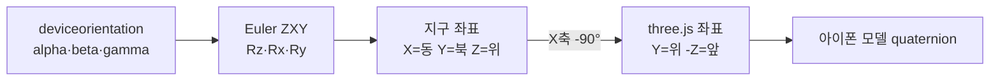

# 📱 IMU 뷰어


아이폰 Safari로 접속하면 기기의 자이로·가속도 센서 값으로 현재 자세를 3D 아이폰 모델에 실시간 반영하는 웹페이지.

👉 https://imu.b-612.kr

---

## ✨ 기능

| 항목 | 설명 |
|------|------|
| 3D 자세 표시 | `deviceorientation`(alpha/beta/gamma)을 쿼터니언으로 변환해 아이폰 모델 회전 |
| 기기 축 | 빨강=X(오른쪽), 초록=Y(화면 위), 파랑=Z(화면 밖) |
| 가속도 화살표 | `devicemotion.acceleration`(중력 제외)을 월드 좌표로 변환해 주황 화살표로 표시 |
| 수치 표시 | 앞뒤/좌우 기울기, 방향(나침반), 자이로 각속도, 가속도, 갱신 주기(Hz) |
| 정면 맞추기 | 현재 바라보는 방향을 화면 안쪽(앞)으로 재설정 |
| 시점 전환 | 정면 / 위 / 측면 / 사선 |

---

## 🧭 좌표 변환



> [!NOTE]
> iOS는 HTTPS + 사용자 터치 후 `DeviceOrientationEvent.requestPermission()` 호출이 있어야 센서 값을 줍니다. 권한을 거부했다면 Safari를 완전히 닫았다가 다시 열어야 다시 물어봅니다.

---

## 🚀 배포

<details><summary>컨테이너 실행</summary>

```bash
docker run -d --name imu-viewer --network npm_network --restart unless-stopped \
  -v $PWD/public:/usr/share/nginx/html:ro \
  -v $PWD/nginx.conf:/etc/nginx/conf.d/default.conf:ro nginx:alpine
```

NPM 프록시 호스트: `imu.b-612.kr` → `imu-viewer:80` (인증서 `*.b-612.kr`)

</details>
