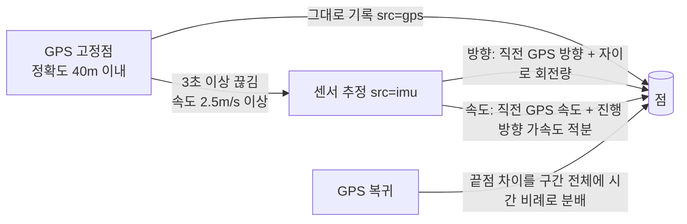
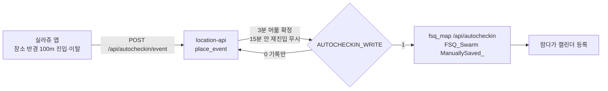

# 📍 위치 기록 (location-log)


아이폰(Safari·홈 화면 앱)으로 이동 경로를 기록하는 웹앱. 기본은 GPS로 기록하고, 터널처럼 GPS가 끊긴 구간은 자이로·가속도·나침반으로 이어 그린 뒤 GPS가 다시 잡히면 보정한다.

👉 https://location.b-612.kr (Tailscale은 바로, 외부는 로그인) · 센서 실험실 `/lab/`

---

## 📱 화면

| 화면 | 내용 |
|------|------|
| 지도 모드 | 전체 화면 지도(네이버, 실패 시 Leaflet+오픈스트리트맵) + 위쪽 오버레이(속도·방향·기록 시간, GPS 상태). 경로는 파랑 실선, 추정 구간은 주황 점선 |
| 기록 모드 | 오버레이 없음. 기록 중이 아니면 "기록 중이 아닙니다", 기록 중이면 `시각  위도, 경도` 줄이 계속 아래로 붙음(추정 점은 `추정` 표시) |
| 공통 | 하단 가운데 기록 시작/종료, 왼쪽 작은 버튼 = 화면 전환, 오른쪽 ⚙ = 설정. 화면을 바꿔도 기록 상태는 그대로 |
| 설정 | 저장된 기록 목록(날짜·거리·시간·점 수), 지도 보기, 이름 변경, 데일리요섭 보내기(연동 준비 중), 삭제 |

> [!NOTE]
> iOS 웹앱은 화면이 꺼지거나 다른 앱으로 넘어가면 실행이 멈춘다. 기록 중에는 화면 꺼짐 방지(Wake Lock)를 켜고, 거치대에 꽂아 화면을 켜 둔 채 쓴다. 멈췄다 돌아온 구간은 직선으로 메우지 않고 "기록 없음"으로 남긴다.

---

## 🛰 경로 계산 (`public/track.js`)



| 학습값 (GPS가 잡힐 때) | 쓰임 |
|------|------|
| 진행 방향 가속도 치우침 (5초 창: GPS 속도 변화 vs 가속도 적분) | 추정 중 속도 적분에서 빼줌 |
| 폰 방위 ↔ 진북 차이 (나침반, 자북 편차 −8.8°) | 가속도를 진행 방향으로 나눌 때 사용 |
| GPS 진행 방향 − 폰 방위 (거치 각도) | 추정 시작 시 방향 기준 |

- 나침반은 차체·터널에서 크게 틀어지므로 2분 이상 끊긴 경우에만, 12° 이내로 어긋날 때만 천천히 반영
- 끊김이 확정되기까지의 3초도 직전 속도·방향으로 채움
- 거치대에 고정된 폰을 가정(손에 들고 돌리면 방향 오차)

<details><summary>합성 주행 시험 결과 (<code>node tools/sim_track.mjs</code>)</summary>

80km/h 전후, 터널 70초(약 1.4km, 터널 안 커브·감속 포함), 터널 후반 나침반 30° 교란:

| 조건 | 복귀 직전 오차 | 보정 후 추정점 오차(RMS) |
|------|------|------|
| 기본 3회 | 60~115m | 8~13m |
| 거치 각도 0°, 교란 없음 | 102m | 8m |
| 가속도 치우침 0.15m/s² | 153m | 19m |
| 손에 들고 흔들림 | 196m | 25m |
| 터널 120초(2.4km) | 352m | 57m |

</details>

---

## 🗄 저장

- 폰: 점마다 IndexedDB에 즉시 저장, 기록 상태는 localStorage → 새로고침·앱 재실행 후 자동으로 이어 기록
- 서버: 5초마다 업로드. `(track_id, seq)` 기준 REPLACE라 재전송·사후 보정이 안전
- MariaDB `location_log` (계정 `loc_rw`, `.env`)

| 테이블 | 내용 |
|------|------|
| `track` | id, client_id, name, started_at, ended_at, distance_m, n_points, n_est, sent_daily_at |
| `track_pt` | track_id, seq, ts(UTC), lat, lon, alt, acc, spd, hdg, src(`gps`/`imu`) |
| `day_pt` | 하루 종일 기록 점: ts(UTC, PK), lat, lon, alt, acc, spd, src(`gps`/`fill`/`trk`…), act(이동 수단) — `server/schema_day.sql` |
| `day_visit` | 하루 종일 기록 머문 곳: arrive(PK), depart, lat, lon, updated_at(데일리요섭 변경 감지) |
| `day_act` | 이동 방식이 바뀐 시각: ts(UTC, PK), act(stationary/walk/run/bike/car), conf(0~2) — iOS 동작 기록, 업로드 때마다 7일치 안에서 지난 커서부터 다시 조회 |
| `day_step` | 1분 걸음: ts(UTC 분 시작, PK), steps, dist_m — iOS 만보계(CMPedometer), 0 걸음 분도 올림. 처음 켜면 2일 거슬러, 한 번에 최대 24시간 |

<details><summary>API</summary>

| 메서드 | 경로 | 내용 |
|------|------|------|
| GET | `/api/config` | 네이버 지도 키 ID, 데일리요섭 연동 여부 |
| GET/POST | `/api/tracks` | 목록 / 생성(client_id 중복이면 기존 것) |
| GET/PATCH/DELETE | `/api/tracks/{id}` | 상세(점 포함) / 이름·종료 시각 / 삭제 |
| POST | `/api/tracks/{id}/points` | 점 일괄 저장 |
| POST | `/api/tracks/{id}/send-daily` | 데일리요섭 보내기 (우선순위 확정 전 503) |
| POST | `/api/log` | 센서 원본 녹화(실험실) → `logs/` |
| POST | `/api/day/points`, `/api/day/visits`, `/api/day/acts`, `/api/day/steps` | 하루 종일 기록 묶음 저장 (ts 기준 REPLACE) |
| GET | `/api/day` | 기록 있는 날짜(한국 시각)·점 수 |
| GET/DELETE | `/api/day/{YYYY-MM-DD}` | 그날 점·머문 곳 / 삭제 |

</details>

---

## 🧪 센서 실험실 (`/lab/`)

이전 IMU 뷰어. 3D 자세 표시, 가속도 2중 적분 궤적(일반·차량 모드, 정지 보정, 구간 사후 보정), GPS·나침반 칼만 융합, 센서 원본 녹화(`⋯` → `● 센서 녹화`). 계산은 `public/nav.js`.

---

## 🚀 배포

```bash
docker compose -p location-log up -d --build   # location-web(nginx 정적) + location-api(FastAPI)
python tests/e2e.py                            # 아이폰 크기 화면 시험 (기록·새로고침 이어가기·목록·이름·삭제)
```

NPM: `location.b-612.kr` → `location-web:80`, 인증서 `*.b-612.kr`, tailscale-auth(3101) 로그인 보호.

> [!WARNING]
> 네이버 지도는 NCP 콘솔 Application의 Web 서비스 URL에 `https://location.b-612.kr` 등록이 필요하다. 등록 전에는 자동으로 Leaflet 지도가 뜬다.

<details><summary>시험 도구</summary>

| 명령 | 내용 |
|------|------|
| `node tools/sim_track.mjs` | 터널 구간 추정·보정 오차 |
| `node tools/sim.mjs` / `sim_gps.mjs` | 실험실 궤적(손동작·차량 진동) / GPS 융합 |
| `node tools/replay.mjs logs/<파일> vehicle` | 실험실 센서 녹화 재생 |

</details>


## iPhone 네이티브 앱 (`ios/`)

SwiftUI 앱. 백그라운드에서도 GPS 기록. `https://location.b-612.kr/app-api/` (Bearer `APP_TOKEN`, `.env`)로 같은 API 사용.
자세한 내용: [ios/README.md](ios/README.md)

## 충전 중 · 운전 · CarPlay (v0.7)
- 충전 중(발열 '심각' 미만): 움직일 때 '정밀', 머무는 동안 GPS 확인 3분마다 (`chargePrecise`)
- 차로 이동(CarPlay 연결 또는 동작 '자동차') + 충전 중: 경로 기록을 자동으로 켬(`Recorder.startAuto`, 이름 '운전 · …' = CarPlay 연결, '차량 이동 · …' = 연결 없음) → 1초 GPS + 터널 센서 추정. 그 점(trk)과 추정점(imu)이 하루 종일 기록에도 들어감. 조건이 풀리면 3분(CarPlay 해제 직후면 1분) 뒤 끔. 직접 켠 기록은 건드리지 않음 (`driveRecord`)
- CarPlay: 1순위 단축어 자동화(CarPlay 연결 시/해제 시) → 앱 동작 `CarPlay 연결 기록하기`/`CarPlay 연결 해제 기록하기` (`CarPlayIntents.swift`, 한 번 받으면 오디오 경로 판정 끔), 2순위 소리 출력 경로의 carAudio (`CarPlay.swift`) → `POST /api/carplay` (쌓아 두고 재전송) → location-api 가 fsq_map `/api/carplay/event` 로 전달(`FSQ_CARPLAY_URL`, `CARPLAY_API_TOKEN` in .env, device='Sillage'). 단축어 대신 (`carplaySend`)

## 자동 체크인 (v0.9) — IFTTT·람다 대체



- 장소: `auto_place` 테이블 (앱이 6시간마다 받아 감, 앱 업데이트 없이 변경). 감시 중심은 실제 머무는 곳 좌표.
- 이벤트: `place_event` (UTC). 상태 `pending → confirmed / ignored(이유) / sent / failed`. 확정 규칙은 `server/autocheckin.py`, 시험 `python3 tests/test_autocheckin.py`.
- 이탈(퇴근)도 확정해 저장 — 데일리요섭 체류 끝 시각에 쓸 예정.
- `AUTOCHECKIN_WRITE=0`(기본)이면 기록만, `1`이면 확정된 진입을 fsq_map으로 넘겨 체크인 저장. fsq_map은 같은 장소 ±10분 체크인이 있으면 저장하지 않음.
