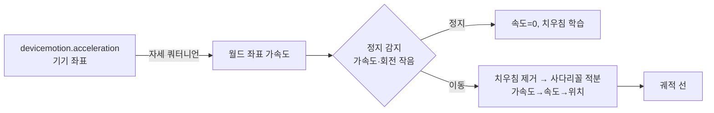
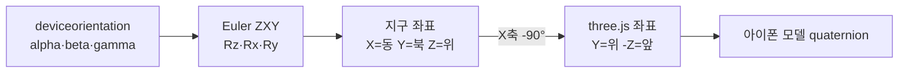

# 📱 IMU 뷰어


아이폰 Safari로 접속하면 기기의 자이로·가속도 센서로 현재 자세를 3D 아이폰 모델에 실시간 반영하고(자세 모드), 가속도를 두 번 적분해 이동 궤적을 3D 그래프에 그리는(궤적 모드) 웹페이지.

👉 https://imu.b-612.kr

---

## ✨ 기능

| 항목 | 설명 |
|------|------|
| 3D 자세 표시 | `deviceorientation`(alpha/beta/gamma)을 쿼터니언으로 변환해 아이폰 모델 회전 |
| 기기 축 | 빨강=X(오른쪽), 초록=Y(화면 위), 파랑=Z(화면 밖) |
| 가속도 화살표 | `devicemotion.acceleration`(중력 제외)을 월드 좌표로 변환해 주황 화살표로 표시 |
| 수치 표시 | 앞뒤/좌우 기울기, 방향(나침반), 자이로 각속도, 가속도, 갱신 주기(Hz) |
| 정면 맞추기 | 현재 바라보는 방향을 화면 안쪽(앞)으로 재설정 |
| 시점 전환 | 정면 / 위 / 측면 / 사선 |
| 궤적 모드 | 3D 좌표축(m 눈금, 범위 자동 확대) 위에 이동 경로를 속도별 색으로 표시, 바닥 그림자 궤적, 손가락으로 회전·확대 |
| 그래프 상자 | 원점은 상자 가운데, 바닥면(채움+격자)은 상자 맨 아래, 천장은 옅은 파랑. 위/아래 라벨 |
| 추 | 상자 윗모서리에 매달린 추가 항상 중력 방향을 가리키고, 움직이면 가속도 반대쪽으로 흔들림 |
| 수평 유지 | 폰을 옆으로 기울여도 그래프의 아래가 실제 땅 방향을 향하도록 화면을 반대로 회전 |
| 중력 정렬 | 위가 위로 보이는 기본 시점으로 카메라 초기화 |
| 원점 초기화 | 위치·속도·궤적을 지우고 현재 방향을 '앞'으로 설정 |
| 정지 보정 | 정지 감지 시 속도를 0으로 고정(ZUPT)하고 센서 치우침을 학습해 빼줌, 약한 속도 감쇠 |

---

## 📈 궤적 계산



### 🚗 차량 모드

| 처리 | 내용 |
|------|------|
| 저역 통과(5Hz) | 노면·엔진 진동 제거 |
| 진동 수준 학습 | 최근 6초 흔들림 하위 20%를 평소 진동으로 보고, 그 2.5배 이하이면 정지로 판정 |
| 기준선 학습 | 정지 중의 가속도(센서 치우침 + 차량 자체 가감속)를 기준선으로 빼줌 |
| 구간 사후 보정 | 손동작이 끝나 정지가 확인되면 남은 속도를 구간 오차로 보고 경로를 다시 계산해 다시 그림 |

### 🛰 GPS·나침반 융합

- 축마다 위치·속도·가속도 치우침 3개 상태의 칼만 필터: 60Hz 가속도로 예측, 약 1Hz GPS 위치(정확도 반영)·속도·진행 방향으로 보정
- 차가 멈춘 것을 GPS 속도로 확인했을 때만 정지 보정 (정속 주행 중 진동이 적어도 속도를 0으로 만들지 않음)
- 나침반(`webkitCompassHeading`)으로 세로축 방위를 계속 맞춰 자이로 방위 드리프트 제거, 월드 좌표 = 동/위/북. 한국 부근은 자북 편차 −8.8° 보정
- GPS 위치에는 수 m 오차가 있어 cm 단위 손동작이 아니라 차량·보행 경로용

### 🧪 시험 도구

| 명령 | 내용 |
|------|------|
| `node tools/sim.mjs` | 합성 진동·차량 가감속·손동작으로 일반/차량 모드 오차 비교 |
| `node tools/sim_gps.mjs` | 합성 주행(가속·커브·정지)에서 GPS만 쓸 때와 융합 오차 비교 |
| `node tools/replay.mjs logs/<파일> vehicle` | 아이폰 "센서 녹화"로 올린 실제 로그를 알고리즘에 다시 넣어보기 |

센서 녹화: 궤적 모드 `⋯` → `● 센서 녹화` → 다시 누르면 서버(`/api/log`, `imu-logger` 컨테이너)로 전송되어 `logs/`에 저장.

> [!WARNING]
> 가속도를 두 번 적분하면 오차가 시간의 제곱으로 커집니다. 수 초 이내 손동작(원·글씨·들어 올리기)은 잘 나오지만, 걸어다니는 수십 초 경로는 정지 보정을 켜도 점점 틀어집니다. 움직임 사이사이 잠깐 멈추면 정확도가 올라갑니다.

---

## 🧭 좌표 변환



> [!NOTE]
> iOS는 HTTPS + 사용자 터치 후 `DeviceOrientationEvent.requestPermission()` 호출이 있어야 센서 값을 줍니다. 권한을 거부했다면 Safari를 완전히 닫았다가 다시 열어야 다시 물어봅니다.

---

## 🚀 배포

<details><summary>컨테이너 실행</summary>

```bash
docker compose up -d   # imu-viewer(nginx 정적) + imu-logger(센서 로그 수신)
```

NPM 프록시 호스트: `imu.b-612.kr` → `imu-viewer:80` (인증서 `*.b-612.kr`)

</details>
